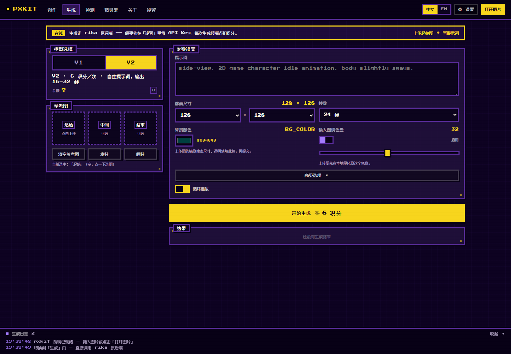

# pxweb

仿 rika-ai.com 前端的**像素素材工具**，纯标准库（`http.server`），零依赖。

本仓库分两块能力：

| 能力 | 位置 | 说明 |
| --- | --- | --- |
| 本地图像处理 | `server.py` + `../pxkit` | 缩放、还原真实分辨率、调色板、精灵表等，全部在本地算，不联网 |
| 模型生成 | `server.py` + `rika.py` | **直接转发 rika 原后端**，本地不重训、不降级。设置页填 Key，生成页出图 |

> 生成能力的开关就在设置页：填好 `API Key` 即可用；不填则只有本地处理能力，互不影响。

## 启动

```bash
python server.py                 # 默认 127.0.0.1:8765，自动开浏览器
python server.py --port 9000 --no-open
```

## 自定义模型配置页

点顶栏「⚙ 设置」或导航「设置」打开。

### 字段

配置页顶部先选**生成后端**，两套字段互斥，只有当前选中的那套会提交。

**后端 = rika 云端**

| 字段 | 用途 | 默认 |
| --- | --- | --- |
| 后端地址 `base_url` | rika 后端根地址，可换成自建镜像/代理 | `https://api.rika-ai.com/v1/api` |
| API Key `api_key` | 以 `X-API-Key` 头发送 | 空 |
| 模型覆盖 `model` | 可选，写进请求体的 `model` 字段；后端不认就忽略 | 空（用后端默认） |

**后端 = 本地 ComfyUI**

| 字段 | 用途 | 默认 |
| --- | --- | --- |
| 服务地址 `comfy_url` | 本机 ComfyUI 的 HTTP 地址 | `http://127.0.0.1:8188` |
| 扩散模型 `unet` | `models/diffusion_models/` 下的文件名 | 空（用 `comfy.py` 的默认值） |
| 文本编码器 `clip` | `models/text_encoders/` 下的文件名 | 空（用默认值） |
| VAE `vae` | `models/vae/` 下的文件名 | 空（用默认值） |

三个模型名留空就用 `comfy.py` 里实测过的默认组合；填了就覆盖，不用改代码。

**两边共用**

| 字段 | 用途 | 默认 |
| --- | --- | --- |
| 请求超时 `timeout` | 单次 HTTP 超时（秒） | `120` |
| 轮询间隔 `poll_interval` | 查 `/jobs` 的间隔（秒） | `4` |
| 轮询上限 `poll_timeout` | 轮询总时长上限（秒） | `900` |

两个安全约定：

- **API Key 只写不回读**。`GET /api/config` 只给脱敏形式（如 `sk-t••••••••••••abcd`）；页面上留空保存表示「保持原值不变」。
- `config.json` 已在 `.gitignore` 里，不会被提交。

### 两个后端的差别

| | rika 云端 | 本地 ComfyUI |
| --- | --- | --- |
| 计费 | 按端点扣积分（v1 4 / v2 6 / 角色 1 / 道具 1 / 地图 2） | 免费 |
| 参考图 | 动画端点至少要一张 | 可纯文生图 |
| 速度 | 排队 + 云端推理 | 取决于本机显卡 |
| 实现 | `rika.py` | `comfy.py` + `localgen.py` |

前端不写死这些差别 —— 它启动时读 `GET /api/caps`，据此决定显示不显示积分、要不要强制参考图、横幅怎么说。换后端不用改前端代码。

### 直接对接的原后端端点

| kind | 路径 | 积分 |
| --- | --- | --- |
| `v1` | `POST /generate` | 4 |
| `v2` | `POST /generate-v2` | 6 |
| `character` | `POST /generate-character` | 1 |
| `item` | `POST /generate-item` | 1 |
| `map` | `POST /generate-map` | 2 |

加上 `GET /credits`（余额）与 `GET /jobs/{gen_id}`（任务状态与结果）。

## 生图页

点顶栏导航「生成」（或直接开 `#gen`）。左栏选模型与参考图，右栏填参数，底部看结果。



### 两个模型

| 模型 | 积分 | 帧数预设 | 请求体差异 |
| --- | --- | --- | --- |
| V1 | 4（原价 5） | 8 / 10 / 12 / 14 / 16 | `pixel_size` 是**字符串**（`"128"`）；`length` = 帧数 × 2 + 1；多带 `motion_type` / `noise_strength` / `scale_factor` |
| V2 | 6（原价 8） | 16 / 20 / 24 / 32 | `pixel_size` 是**对象** `{x,y}`；`output_frames` 直接给帧数；带 `padding` 与 `ai_expand` |

价格按 rika 自己按钮的写法显示：划线原价 + 现价。两边都从 `GEN_COST` 取，改价只改一处。

### 参考图

三格：**起始**（必填）、**中间**（可选）、**结束**（可选）。点格子选图；选中后可「旋转」90° 或「翻转」。
后端只收纯 base64（不带 `data:` 前缀），前端已剥掉。

上传的图会先在本地缩到目标像素尺寸（`imageSmoothingEnabled = false`，保持硬边），
透明区域填成「背景颜色」，勾了调色盘就再量化到指定色数——**这些全是本地预处理，不进请求体**。

### 参数

| 字段 | 适用 | 说明 |
| --- | --- | --- |
| 提示词 | 都有 | 英文描述最稳。留空时 V1 会用所选动作的预设提示词（与 rika 前端逐字一致） |
| 动作类型 | V1 | idle / walk / run / jump / attack / hit / defeated；切换到 `attack` 会多出「攻击子类型」 |
| 像素尺寸 | 都有 | V1 是单个 32/64/128/256；V2 是 `x`×`y`，两轴都必须是 32 的倍数、范围 32–256 |
| 帧数 | 都有 | 见上表 |
| 背景颜色 | 都有 | 本地合成用，默认墨绿 `#004040` |
| 输入图调色盘 | 都有 | 本地中位切分量化；阈值 2–64 色，默认 32 |
| AI 扩写 | V2 | `ai_expand`，只扩服务端内部，不改你的提示词 |
| 固定种子 | 都有 | 不固定时每次随机一个 0–999999 的种子（与 rika 一致） |
| 噪声强度 | V1 | 0–2，默认 0.6（服务端默认 0.8，网页端一直是 0.6） |
| 留白扩边 | 都有 | V1 传 9 宫格 `padding_position`；V2 传四边数值 `padding` |
| 循环播放 | 都有 | 只影响本地预览，不进请求体 |

### 留白与 V2 的 pixel_size

V2 提交的 `pixel_size` **不是**内容尺寸，而是「内容 + 四边留白」后的画布尺寸：

```
pixel_size.x = size.x + padding.left + padding.right
pixel_size.y = size.y + padding.top  + padding.bottom
```

四边留白按 32 步进，且会被夹到「每边不超过 `256 - 内容尺寸`、总和不超过 `256 - 内容尺寸`」。
界面上的「四边留白」下面会实时显示最终提交的 `pixel_size`，避免只看数字猜。

### V1 的 scale_factor

与 rika 前端逐字一致：

```
有留白：256→2，32→12，其余 384/size
无留白：32|64→512/size，其余 768/size
```

### 结果

提交后每 3 秒轮询一次 `/api/job`，上限 15 分钟。拿到 `output_images[0].url` 后渲染：

- 精灵表大图 + `gen_id` / `job_type` / `status` 元信息
- 「打开原图」直连后端给的地址；「同参数重跑」省得重填；「送去创作页」把结果拽回本地工具继续加工
- 宽度能被帧数整除时自动切出逐帧条 + 循环播放（12 fps，跟随「循环播放」开关）；除不尽只提示，不瞎猜布局

### 拦截顺序

与 rika 前端保持一致，先撞哪个就报哪个：

1. 没有起始图 → 「先上传「起始」参考图」
2. 提示词为空 → 「提示词不能为空」
3. 余额不足 → 「积分不足：V2 需要 6，当前余额 N」

余额在左栏「模型选择」卡里显示，刷新按钮走 `POST /api/credits`。
Key 无效时显示 `?` 并把鼠标悬停提示设为后端的原始报错——不假装有余额。

### 网络上的两个小动作

rika 后端在本机会偶发 TLS 中断（`UNEXPECTED_EOF_WHILE_READING` / `WSAECONNABORTED 10053`），
所以 `rika.py` 里做了三件事：

1. 显式 TLS 上下文（≥ TLS1.2）+ 正常浏览器 UA —— 有些 CDN/WAF 会掐掉裸 urllib 的握手。
2. `GET` 幂等，失败自动重试 3 次。
3. `POST /generate*` **发出后不重试**（重发就是重复扣积分）；为了不让用户白点，提交前先用
   `GET /credits` 预检，链路通、Key 有效才发 POST。

> 取舍写在明面上：宁可多花一次 GET 的几十毫秒，也不冒一次重复扣 6 积分的风险。

## HTTP 接口

```
GET  /                       前端页面
GET  /static/*               静态资源
GET  /work/<id>.png          处理结果
POST /api/open               导入图片（dataURL）→ {key, w, h}
POST /api/op                 执行操作 → {key, w, h, info, palette?, tiles?}

GET  /api/caps               当前后端能力（哪些 kind、收不收积分、要不要参考图）
GET  /api/config             读取配置（api_key 已脱敏）
POST /api/config             保存配置
POST /api/config/test        用候选配置测连通性 → {ok, credits}
POST /api/credits            查询积分余额（本地后端返回 credits: null）
POST /api/gen                提交生成任务 → {gen_id, kind, credits}
POST /api/job                查询任务 {gen_id, wait?} → {job}
```

`rika.RikaError` 的错误会原样映射成中文并带上原状态码（401/402/429 等），前端直接显示在设置页底部状态栏。

## 离线自检

三份浏览器端断言，都不消耗积分：

```bash
python server.py --port 8765 --no-open   # 另开一个终端
node verify_gen.js                       # 生图页参数拼装（82 条）
node verify_cfg.js                       # 设置页后端切换（19 条）
node run_probe.js verify_local.probe.js  # 本地后端行为（11 条）
```

三者都用 headless Chrome + CDP（`node` 内置 `WebSocket`，不需要 `npm i`）：

- `verify_gen.js` —— V1/V2 参数拼装、留白夹取、`scale_factor`、动作联动、切片、拦截顺序，顺带重拍 `docs/gen-page.png`。
- `verify_cfg.js` —— 设置弹层的 rika / 本地 ComfyUI 切换：哪些字段显示、哪些隐藏、端点表对不对。
- `run_probe.js <任意 probe.js>` —— 通用跑器，第二个参数给截图文件名就会存进 `docs/`。

`*.probe.js` 是注入页面的断言脚本本体，改逻辑时对着改。`verify_local.probe.js`
会先把后端切成 ComfyUI —— 它需要本机 ComfyUI 真的在 8188 上跑着。

## 目录

```
pxweb/
├── server.py             HTTP 服务（本地处理 + 生成代理）
├── rika.py               rika 云端后端客户端（配置读写 + 转发）
├── comfy.py              本地 ComfyUI 适配层（提交 prompt / 轮询 / 取图）
├── localgen.py           把 rika 的参数语义翻译成本地 ComfyUI 管线
├── config.json           运行时生成，含 API Key，勿提交
├── verify_gen.js         生图页离线自检（82 条）
├── verify_cfg.js         设置页后端切换自检（19 条）
├── run_probe.js          通用 CDP 探针跑器
├── *.probe.js            注入页面的断言本体
├── static/
│   ├── index.html
│   ├── app.css
│   └── app.js
├── docs/                 界面截图（README 用）
└── work/                 处理中间产物
```

